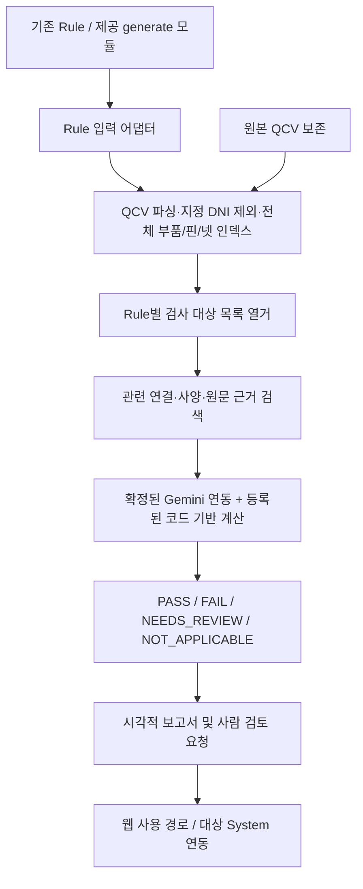

# CircuitAgent 추가 요구사항 및 MVP 개발 방향

> 정리 기준일: 2026-10-09 (한국 시간)
> 상태: 최신 협의 내용을 정리한 기획 문서. 구현 완료나 성능 검증을 의미하지 않는다.

## 1. 문서의 기준과 우선순위

이 문서는 사용자가 새로 전달한 협의 메모와 이후 정리된 MVP 방향을 기록한다. [PROJECT_REQUIREMENTS.md](PROJECT_REQUIREMENTS.md)는 최초 기획 자료로 원문을 보존한다. **최초 기획과 이 문서의 범위가 다를 경우, 현재 MVP 개발에서는 이 문서의 최신 범위를 우선한다.** 최초 문서의 넓은 기능 목록이나 예시 수치를 모두 초기 구현 대상으로 간주하지 않는다.

아래 구분을 사용한다.

| 구분 | 의미 |
|---|---|
| 협의 내용 / 현재 범위 | 사용자 메모에서 전달된 사실과 현재 정리된 목표·우선 작업. 실제 파일과 코드가 확인됐다는 뜻은 아니다. |
| 구현 제안 | 목표를 실현하기 위해 제안한 구성·처리 방법·개발 순서. 샘플과 인터페이스 확인 후 조정한다. |
| 미확정 사항 | 추가 자료나 담당자 답변이 필요하며, 특정 제품·형식·동작을 임의로 결정하지 않은 항목. |
| 엔지니어링 추정 | 조건부 난이도·기간 평가. 확정 요구사항이나 일정 약속이 아니다. |

이 문서를 작성하면서 실제 QCV, 기존 Rule, generate 코드, 엔지니어 기준 결과를 검증한 것은 아니다. 문서 정리 자체에는 구현 코드 개발이나 모델 설치를 포함하지 않는다.

## 2. 새 협의 메모와 해석 상태

원문의 표현과 의미를 다음과 같이 보존한다. 구현에 필요한 해석과 미확정 사항은 별도로 표시한다.

| 전달된 표현 / 내용 | 현재 반영 방향과 확인할 사항 |
|---|---|
| “gemini cli로 내부로 이용” | Gemini CLI 이용 의향. 실제 실행 위치, 인증, 모델 처리 위치, 개발 보조/제품 실행 역할은 미확정이다. |
| “웹으로 이용” | 웹 사용 경로를 목표로 한다. 자체 웹 UI인지 기존 Gemini 웹 서비스인지는 미확정이다. |
| “generate는 그대로 모듈형식으로 붙이면 된다. 코드로 제공해 주시지만, 크게 신경쓸 필요 없다” | 제공되는 generate 모듈을 연결한다. 생성기 자체를 재개발하지 않으며 실제 코드·입출력은 확인이 필요하다. |
| “클라인 SR” | 정확한 의미를 확인한다. Cline 등 특정 제품이나 기능으로 확정하지 않는다. |
| “rule은 있는거” | 기존 Rule을 활용한다. 전달 형식, 지원 목록, 적용 조건은 자료로 확인한다. |
| “qcv 파일 이용해서 RAG 처럼 하면 될거 같다” | Rule별 필요한 회로 근거를 검색하는 방식으로 해석한 구현 제안이다. 벡터 DB가 필수라는 뜻으로 확정하지 않는다. |
| “System과 연결 했으면 좋겠다” | 대상 System 연동을 목표로 한다. 이름, 역할, 인증, 인터페이스는 미확정이다. |
| “고도화된 Rule은 안하면 된다” | 새로운 고도화 Rule 개발은 초기 범위에 포함하지 않는다. |
| “최종 형태는 레포트 형태로 (시각적)” | 사람이 결과와 근거를 확인할 수 있는 시각적 보고서를 제공한다. 최종 파일 형식과 UI는 미확정이다. |
| “덜틀리는게 중요함” | 오판을 줄이는 것을 우선한다. 자동 검사 범위와 보류 비율도 함께 평가한다. |
| “애매한건 사람한테 시켜라” | 정보가 부족하거나 해석이 모호한 항목은 사람 검토로 넘긴다. |
| “DNI -> Test용 (안봐도 된다) 전처리로 날리고 시작” | 협의에서 지정한 DNI 대상을 검사 모델에서 제외한다. 실제 표시 필드·값과 제외 단위는 샘플로 확인한다. |
| QCV가 만 줄 이상으로 커서 전체 입력 시 Context 제한 가능성이 있고 사전 전처리가 필요함 | 전달된 파일 규모에 관한 메모다. 실제 파일과 모델의 토큰 한도는 아직 확인하지 않았으며 전처리와 요청별 예산 관리가 필요하다. |
| “일단 돌아가는 것에 중점으로 두자” | 기본 Rule과 제한된 사례에서 입력부터 보고서까지 동작하는 흐름을 먼저 만든다. |

## 3. 현재 MVP 목표와 범위

### 목표

**제공되는 generate 모듈과 기존 Rule을 활용하여 QCV를 전처리하고, 각 검사에 필요한 회로 근거를 검색해 검증한 뒤, 사람 검토 항목을 포함한 시각적 보고서를 생성한다.**

우선 동작하는 전체 흐름을 만들되, 근거가 부족한 판정을 통과로 처리하지 않는다. 실제 지원할 기본 Rule과 대상 인스턴스는 제공 자료와 하드웨어 담당자의 기준 결과를 확인해 정한다.

### 우선 작업

1. 제공 generate 모듈의 입출력을 연결한다.
2. 기존 Rule을 입력받고 식별자·버전·적용 조건을 관리한다.
3. QCV를 파싱하고 지정 DNI 대상을 제외하여 부품·핀·넷 인덱스를 만든다.
4. Rule별 검사 대상을 열거하고 관련 연결·사양·원문 근거를 검색한다.
5. 지원하는 기본 검증과 등록된 코드 기반 수치 계산을 수행한다.
6. 판정·근거·계산 결과와 사람 검토 요청을 시각적 보고서로 제공한다.
7. 확정된 Gemini 실행 경로 및 웹·System 인터페이스를 연결한다. 구체적인 제품과 연동 방식은 확인 후 반영한다.

### 초기 범위에 포함하지 않는 작업

- generate 생성기 자체의 재개발
- 새로운 고도화 Rule 개발
- 모델 학습 또는 파인튜닝
- 전체 PCB 레이아웃 검증

위 작업은 별도 합의 없이 최초 기획에서 초기 범위로 가져오지 않는다. 벡터 DB 구축도 MVP의 필수 조건으로 가정하지 않는다.

### BOM과 부품값

BOM은 최초 기획에 언급됐지만 최신 협의에서는 제공 여부가 확정되지 않았다. 먼저 QCV에 검사에 필요한 부품값과 속성이 포함돼 있는지 확인한다. 부족한 값이 있으면 BOM 등 추가 입력이 필요하다고 표시하고, 해당 검사는 정보 확보 전까지 보류한다. 파트넘버나 모델 이름만으로 필요한 사양을 임의로 채우지 않는다.

## 4. 입력과 결과물

다음 표는 현재 흐름을 위한 확인 목록이며, 실제 입력 스키마를 확정한 것은 아니다.

| 입력 / 자료 | 용도 | 확보·확인할 내용 |
|---|---|---|
| 기존 Rule | 검사 기준 | 형식, 지원 목록, 식별자·버전, 적용 대상·조건, 단위, 기준·오차, 근거 |
| 제공 generate 코드 | Rule 생성 결과 연결 | 호출 방법, 입출력, 오류 처리, 의존성과 실행 환경 |
| 원본 QCV | 부품·핀·넷 연결과 속성 | 실제 문법, 부품 ID·모델·값, 교차 참조, DNI 표시, 파일 규모 |
| 설계 조건·추가 부품 정보 | Rule 계산과 적용 조건 확인 | QCV에서 부족한 값, 필요 시 BOM, 목표값·허용오차·동작 조건 |
| 엔지니어 기준 결과 | 연결 해석·계산·판정 검증 | 정상·위반·누락·모호성 사례와 Rule·인스턴스별 정답 및 근거 |
| Gemini·웹·System 연결 정보 | 실행과 사용 경로 연결 | 역할, 인증, 데이터 흐름, 인터페이스, 오류·응답 처리 |

결과물은 판정과 계산값만이 아니라, 검사 범위·근거·보류·오류·DNI 제외 기록을 포함한다. 사람의 답변과 답변을 반영한 재검증 결과는 최초 자동 판정과 구분하여 기록한다.

## 5. 제안 아키텍처

**아래 흐름은 현재 단계의 구현 제안이다.** 실제 제공 코드, QCV 문법, Rule 형식, 실행 경로가 확인되면 조정한다.

파싱·실행 오류는 별도 오류 기록으로 보고서에 포함한다. Gemini가 제품 실행 엔진으로 쓰일지 개발 보조 도구로 쓰일지는 아직 미정이므로, 위 모델 연동 단계의 구체적인 역할도 확정 후 반영한다. 연결 분석과 계산의 재현 가능성은 모델의 확신 표현과 구분한다.

## 6. 대용량 QCV 전처리와 근거 검색

### 원본 보존과 검사 모델

- 원본 QCV를 보존하고, 검사용 구조 모델을 별도로 만든다.
- 부품 ID, 모델, 핀, 넷, 속성을 파싱하고 전체 파일에서 교차 참조를 해결한다.
- 원본 줄 또는 블록 위치를 보존해, 검색 결과와 판정에서 실제 근거로 돌아갈 수 있게 한다.
- 지정된 DNI 대상은 검사 모델에서 제외하고 대상·개수·이유를 기록한다. DNI 의미와 제외 규칙을 샘플로 확인하기 전에는 임의의 문자열을 기준으로 제외하지 않는다.
- 문자열 줄 삭제나 전역 단순 치환으로 부품 블록과 참조를 망가뜨리지 않는다. 제외 대상과 연결되는 참조도 구조적으로 처리하며, 해석되지 않은 참조를 정상 연결로 간주하지 않는다.

### Rule별 검색과 검사 범위

1. 전체 인덱스에서 Rule별 검사 대상 목록을 먼저 열거한다. 검색된 일부 항목만 검사한 결과를 전수 검증이라고 표시하지 않는다.
2. 대상 부품·핀·넷의 구조적 조회로 관련 연결과 속성을 찾는다. Rule이 요구하는 범위를 기준으로 관련 회로를 추적한다.
3. 필요한 경우 텍스트 검색이나 벡터 검색을 보조 수단으로 추가한다. 단순 텍스트 청킹이나 벡터 유사도만으로 회로 연결이 완전하다고 판단하지 않는다.
4. 모델에 전달할 근거에는 대상 식별자와 원본 위치를 포함한다. 모델이 제시한 부품과 위치가 실제 입력에 존재하는지도 확인한다.

### 문맥 예산과 실패 처리

QCV의 줄 수와 토큰 수는 다르다. 만 줄 이상의 파일이라는 메모만으로 모델에 넣을 수 있는지 결정하지 않는다. 실제 모델의 문맥 한도와 입력·출력 여유를 확인하고 요청별 토큰 예산을 관리한다. 전체 QCV를 매 요청에 넣는 방식을 기본 전제로 삼지 않는다.

검색 범위 부족, 해석되지 않은 참조, 파싱 실패, 문맥 제한은 사유와 영향받는 범위를 기록한다. 결과의 의미에 따라 판정 보류 또는 실행 오류로 처리하며, 근거가 부족한 항목을 PASS로 바꾸지 않는다.

## 7. 오판 감소와 사람 검토

### 자동 판정 원칙

- 적용 대상·조건·단위·근거가 확보된 Rule만 실행한다.
- 계산 가능한 항목은 등록된 계산 코드로 재현한다. 입력값·계산식·기준·오차를 함께 남긴다.
- LLM의 확신 표현만으로 최종 판정을 확정하지 않는다.
- 모델이 제시한 부품과 근거 위치를 실제 입력과 대조한다.
- 값 누락, 연결 모호성, 조건 불명확, 지원하지 않는 Rule은 `NEEDS_REVIEW`로 보낸다.

| 판정 | 의미 |
|---|---|
| `PASS` | 필요한 근거가 확보됐고, 해당 대상과 조건에서 실행한 Rule을 충족한다. |
| `FAIL` | 필요한 근거가 확보됐고, 해당 대상과 조건에서 Rule 위반을 확인했다. |
| `NEEDS_REVIEW` | 정보 부족·해석 모호성·지원하지 않는 Rule 등으로 자동 판정을 확정할 수 없다. |
| `NOT_APPLICABLE` | 해당 대상 또는 조건에 Rule이 적용되지 않는다는 근거가 확인됐다. |

`NOT_APPLICABLE`을 지원하지 않는 Rule이나 불명확한 조건을 숨기는 용도로 사용하지 않는다. 파싱 실패나 계산·실행 오류는 별도로 기록하고 영향받는 검사 범위를 표시한다. 미검증·DNI 제외·보류·오류는 PASS가 아니다.

### 사람 검토 요청

검토 요청에는 대상 인스턴스, Rule, 확인 필요 이유, 관련 연결과 원문 근거, 필요한 추가 정보를 담는다. 담당자의 답변과 재검증 결과를 별도로 기록해, 처음에 무엇이 불명확했고 이후 어떤 근거로 판정했는지 추적할 수 있게 한다.

사용자는 컴퓨터공학 전공자이며 전기전자 회로 도메인 경험이 적다는 배경을 전달했다. 파서·그래프·계산·웹을 개발하고, Rule 해석과 기준 정답 확인에는 하드웨어 담당자와 협업하는 방식이 적합하다는 제안이다.

### 평가 기준 제안

- 실제 위반을 PASS로 잘못 판정한 오류와, 정상 사례를 FAIL로 잘못 판정한 오류를 각각 확인한다.
- 자동 검사 완료율과 보류율을 함께 평가한다. 대부분의 항목을 보류하는 시스템을 정확도만으로 성공이라고 평가하지 않는다.
- 정상·위반·값 누락·연결 모호성·대용량 사례에서 엔지니어 기준 결과와 대조한다.
- 보고서의 대상 목록과 실제 실행 결과를 대조해 누락된 검사가 있는지 확인한다.

정확도, 자동 검사 완료율, 보류율, 처리 시간의 수치 목표와 집계 분모는 아직 확정되지 않았다. 최초 기획의 **100% 자동화, Zero Human Error, 1초 검증, 전체 FULL PASS** 등은 검증된 성능이 아니며 최신 MVP의 달성 사실로 쓰지 않는다.

## 8. 시각적 보고서

시각적 보고서는 현재 요구 방향이다. **웹에서 보는 HTML 보고서는 초기 구현 제안**이며, 최종 형식이 HTML·PDF·다른 형식 중 무엇인지와 상세 UI는 아직 확정되지 않았다.

보고서에 포함할 정보는 다음과 같다.

| 항목 | 내용 |
|---|---|
| 검사 범위와 개수 | 전체 대상, 검사 완료, 확인 필요, 오류, DNI 제외 개수 |
| 판정 요약 | PASS / FAIL / NEEDS_REVIEW / NOT_APPLICABLE별 결과 |
| 상세 결과 | 부품·인스턴스·Rule별 판정과 관련 연결, 원문 근거 위치 |
| 계산 근거 | 입력값·단위·계산식·계산 결과·판정 기준·오차 |
| 사람 검토 목록 | 보류 이유, 확인할 정보, 관련 근거, 답변과 재검증 결과 |
| 실행 식별 정보 | 입력 식별 정보, Rule 버전, 실행 시각 |

부품 수와 Rule별 검사 건수를 구분하고 집계 단위·분모·검사 범위를 표시한다. 미검증·제외·오류를 PASS로 집계하지 않는다. 특정 Rule에서 완료한 결과를 회로 전체의 FULL PASS나 안전성 보장으로 확대하지 않는다.

## 9. Gemini CLI·웹·System의 미확정 사항

### Gemini CLI

“CLI를 사내 PC에서 실행”하는 것과 “모델 추론 및 데이터가 완전히 사내에서 처리”되는 것은 다르다. 공식 Gemini CLI는 Google 로그인, Gemini API, Vertex AI 등 연결 방식을 제공한다. 이 사실만으로 회사의 연결 방식이나 데이터 처리 위치를 확정할 수는 없다.

회사의 실제 연결·인증·게이트웨이와 모델 처리 위치를 확인해야 한다. Gemini CLI가 개발 보조 도구인지 제품 실행 엔진인지도 미정이다. 제품 실행에 사용한다면 확정된 실행 경로에 맞춰 문맥·응답·오류 관리를 설계한다.

공식 참고 자료:

- [Gemini CLI 인증 방식](https://geminicli.com/docs/get-started/authentication/)
- [Gemini CLI Headless 실행](https://geminicli.com/docs/cli/headless/)

### 추가 확인 목록

| 미확정 항목 | 필요한 확인 |
|---|---|
| “웹으로 이용” | 자체 웹 UI인지 기존 Gemini 웹 서비스인지, 사용 흐름과 보고서 접근 방식 |
| “클라인 SR” | 정확한 명칭·의미·역할. Cline 등 특정 제품으로 임의 해석하지 않는다. |
| 대상 “System” | 이름, 역할, 인증, 입력·출력 인터페이스 |
| Gemini 실행 경로 | 개발 보조/제품 실행 역할, 실제 연결·인증·게이트웨이, 모델 처리 위치 |
| QCV와 DNI | 실제 문법·필드·값, 제외 단위, 교차 참조와 부품값의 존재 여부 |
| 기존 Rule과 generate | 실제 파일·코드, 호출 방법, 입출력, 적용 대상·조건·단위·근거 |
| BOM 등 추가 입력 | 제공 여부와 QCV에서 부족한 사양의 보완 방법 |
| 기본 Rule·검증 범위 | 우선 지원 목록과 대상 인스턴스, 엔지니어 기준 결과 |
| 보고서와 평가 기준 | 최종 형식·UI, 검토 절차, 정확도·완료율·보류율·처리 시간의 목표 |

## 10. 개발 순서 제안

다음은 구현 순서 제안이며, 제공 자료와 인터페이스 확인 결과에 따라 조정한다.

1. **자료와 기준 결과 확보:** 기존 Rule·QCV·generate 코드와 엔지니어 기준 결과를 받고 입출력 및 DNI 제외 규칙을 확인한다.
2. **검사 모델 생성:** QCV 파싱, DNI 제외, 원문 근거 보존, 부품·핀·넷 인덱스를 구현한다.
3. **최소 검증 흐름:** 기존 기본 Rule 하나와 인스턴스 하나에서 검색·계산·판정을 기준 결과와 일치시킨다.
4. **최소 시각적 보고서:** PASS·FAIL·보류 및 근거를 포함한 보고서를 만든다.
5. **Gemini 실행 경로 연결:** 확정된 역할과 방식에 따라 Gemini를 연결하고 문맥·응답·오류를 관리한다.
6. **검사 확대와 평가:** 기본 Rule과 검사 대상을 확대하며 정상·위반·누락·모호성·대용량 사례를 평가한다.
7. **웹·System 연결:** 확정된 웹 사용 경로와 System 인터페이스에 연결한다.

## 11. 실현 가능성·난이도·일정 추정

**이 절은 엔지니어링 추정이며 확정 일정이나 성능 약속이 아니다.** 현재 정리한 범위는 실현 가능한 MVP로 판단했고, 체감 난이도는 중상, 10점 중 약 6~7점으로 추정했다. 가장 어려운 부분은 QCV에서 필요한 연결을 빠짐없이 찾고 실제 정확도를 검증하는 것이다.

| 작업 | 추정 난이도 |
|---|---|
| 제공 generate 모듈 연결 | 낮음~중간 |
| QCV 파싱·DNI 제외 | 중간~높음 |
| Rule별 관련 회로 검색 | 높음 |
| 실제 정확도 검증 | 높음 |
| 기본 수치 계산 | 중간 |
| Gemini 연동 | 중간 |
| 웹 보고서 | 중간 |

기간 추정은 **Python과 웹 개발에 익숙한 1명이 샘플·기존 Rule·제공 코드·정답을 바로 받는 조건**을 전제로 한다.

| 단계 | 조건부 추정 기간 |
|---|---|
| 단일 Rule 데모 | 2~3주 |
| 기본 Rule 몇 개와 오류·보류·보고서를 갖춘 MVP | 4~8주 |
| 실제 업무 운영 수준 | 지원 범위·검증 결과·연동 환경에 따라 추가 기간 필요 |

각 기간은 해당 단계에 도달하기 위한 추정이며 확정 일정으로 합산하거나 착수일·완료일을 약속한 것이 아니다. 자료 확보, QCV 문법, Rule 해석, 하드웨어 담당자 검토, 연동 환경에 따라 다시 산정한다.
